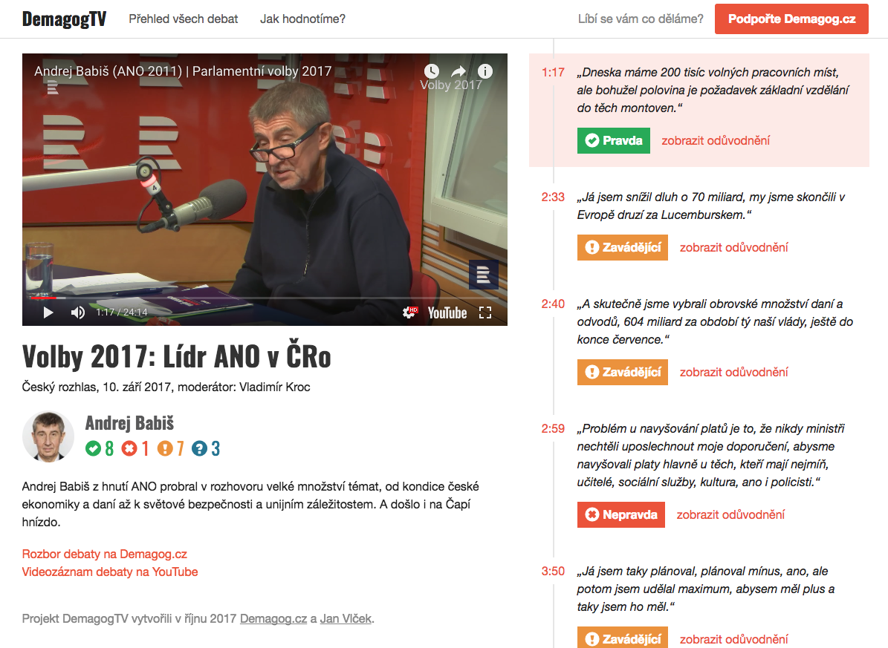

# DemagogTV

Sledujte rozhovor a zároveň, zda politik říká pravdu či ne. Propojili jsme
videozáznamy debat s výroky tak, že v čase vyřčení naskočí hodnocení od
[Demagog.cz](http://demagog.cz). [https://demagogtv.cz](https://demagogtv.cz)

*[Go to description in English](#project-description)*



## Technologie

* UI postaveno v Reactu (React 19) a [Next.js](https://nextjs.org/) (App Router)
* Web je staticky generovaný (`next build` s `output: 'export'`) — žádný běžící
  server není potřeba, výstupem je adresář `out/` se statickým HTML/JS
* Vyžaduje Node.js 24 (viz `.nvmrc`)

## Spuštění lokálně

Vývojový server:

```
git clone git@github.com:vlki/demagogtv.git
cd demagogtv
nvm use            # Node 24
npm install
npm run dev        # http://localhost:3000
```

Produkční statický build:

```
npm run build      # vygeneruje statický web do out/
```

## Nasazení

`npm run build` vyprodukuje plně statický web do adresáře `out/`. Ten stačí
naservírovat jako statické soubory (libovolný statický hosting / CDN — např.
Netlify, Vercel, GitHub Pages, S3, Nginx). Oproti původní verzi už není potřeba
provozovat Node.js/Express server.

## Licence

* Data o výrocích a obrázky patří projektu [Demagog.cz](http://demagog.cz)
* Kód je pod licencí [MIT](LICENSE.md)

---

## Project description

Integration of political debate video with factchecking so the viewer can watch the debate and see the checked facts from Czech factchecking organization [Demagog.cz](http://demagog.cz) at the same time.

See screenshot above for demonstration (video on the left, checked facts on the right).
